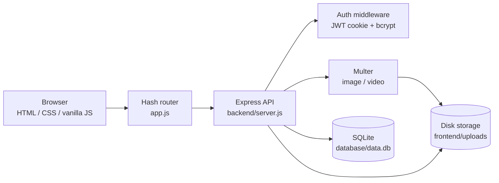

# Wave

<div align="center">

[](https://nodejs.org/)
[](https://expressjs.com/)
[](https://www.sqlite.org/)
[](./Dockerfile)
[](./package.json)

**A production-shaped, Instagram-style social platform built with Express, SQLite and vanilla JavaScript.**

</div>

---

## Table of contents

- [Overview](#overview)
- [Feature highlights](#feature-highlights)
- [Project structure](#project-structure)
- [Architecture](#architecture)
- [Tech stack](#tech-stack)
- [Data model](#data-model)
- [Getting started](#getting-started)
- [Configuration](#configuration)
- [Docker deployment](#docker-deployment)
- [Feature walkthrough](#feature-walkthrough)
- [API reference](#api-reference)
- [Example requests](#example-requests)
- [Engineering decisions](#engineering-decisions)
- [Security considerations](#security-considerations)
- [Quality checks](#quality-checks)
- [Roadmap](#roadmap)
- [Contributing](#contributing)
- [License](#license)

---

## Overview

Wave is a full-stack social media application created for **CodeAlpha Task 2**. It goes beyond a static demo: posts, comments, likes, follows, stories, reels, direct messages, notifications and search are all real, database-backed operations.

The frontend is intentionally framework-free. It talks to a versioned REST-style API (`/api/*`) using `fetch`, an HTTP-only JWT cookie for authentication, and `FormData` for media uploads. The backend persists everything in SQLite and serves uploaded media from `/uploads`.

| Property | Value |
| --- | --- |
| Type | Full-stack web application |
| Domain | Social media / content sharing |
| Backend | Node.js, Express 5, SQLite |
| Frontend | HTML, CSS, vanilla JavaScript |
| Auth | JWT in HTTP-only cookie, bcrypt hashing |
| Media | Local disk storage via multer (images + video) |
| Default port | `3000` (configurable) |

---

## Feature highlights

- **Real content pipeline** — create posts with an uploaded image/video, camera capture, camera recording, or a remote URL. Hashtags and `@mentions` are parsed and persisted.
- **Stories** — 24-hour expiration, view counts, seen state, keyboard navigation, and owner deletion.
- **Reels** — short-form media with their own feed, likes and comments.
- **Direct messages** — conversation list, unread counters, text/media attachments and "seen" state.
- **Activity feed** — notifications for likes, comments, comment likes, follows, follow requests, mentions and messages.
- **Real unified search** — search people, post captions, hashtags and tags through a single endpoint, with an instant dropdown and a full results view.
- **Privacy controls** — public/private accounts with a follow-request approval workflow.
- **Engagement primitives** — likes, comment likes, saves, follows, share links and double-tap-to-like.

---

## Project structure

The repository is separated by responsibility so each layer can be understood and worked on independently:

```text
CodeAlpha_Social-Media/
├── backend/                 # Node.js application
│   ├── server.js            # Express API, auth, uploads, routes
│   ├── db.js                # SQLite connection, schema and migrations
│   ├── package.json         # Backend dependencies and npm scripts
│   └── package-lock.json
├── frontend/                # Static assets served by Express
│   ├── index.html           # App shell, views and templates
│   ├── app.js               # Hash router, state and API calls
│   ├── styles.css           # Dark cinematic design system
│   └── uploads/             # User media (runtime, gitignored)
│       └── .gitkeep
├── database/                # Persistent data
│   ├── data.db              # SQLite database (runtime, gitignored)
│   └── .gitkeep
├── Dockerfile               # Multi-stage production image
├── docker-compose.yml       # Port 5000 + persistent volumes
├── .dockerignore
├── .gitignore
└── README.md
```

> `data.db` and `frontend/uploads/` are generated at runtime and excluded from version control. The `.gitkeep` files keep their parent directories present in the repository.

---

## Architecture



### Request lifecycle

1. The browser sends `fetch` requests to `/api/*`.
2. `cookie-parser` reads the JWT from the HTTP-only `token` cookie.
3. `optionalAuth` or `authRequired` attaches `req.user` and refreshes `last_seen`.
4. Route handlers validate input, perform SQLite operations and emit notifications where relevant.
5. Media endpoints stream files through multer into `frontend/uploads/` and return a URL such as `/uploads/1690000000-abc123.jpg`.
6. The frontend re-fetches the active route and re-renders the affected view.

---

## Tech stack

| Layer | Technology | Why |
| --- | --- | --- |
| Runtime | Node.js 22 | Modern `fetch`, stable native modules |
| HTTP | Express 5 | Minimal, predictable routing and middleware |
| Database | SQLite (`sqlite3`) | Zero-config persistence, ideal for a demo/learning project |
| Auth | `jsonwebtoken`, `bcryptjs` | Stateless sessions with hashed passwords |
| Uploads | `multer` | Multipart handling with MIME filtering and size limits |
| Config | `dotenv` | Environment-driven secrets and ports |
| Frontend | Vanilla JS + CSS | No build step, easy to inspect and deploy |
| Containers | Docker + Compose | Reproducible runtime with persistent volumes |

---

## Data model

| Table | Purpose |
| --- | --- |
| `users` | Credentials, profile fields, avatar, phone, privacy flag, last seen |
| `posts` | Posts and reels (`kind`, `media_type`, caption, media URL) |
| `comments` | Post comments with optional media |
| `likes` | Post likes (composite primary key) |
| `comment_likes` | Comment likes |
| `saved_posts` | Bookmarks |
| `follows` | Follow graph |
| `follow_requests` | Pending requests for private accounts |
| `stories` | Ephemeral media with creation timestamp |
| `story_views` | Viewer/story relation for view counts and seen state |
| `hashtags` / `post_hashtags` | Normalized tags and post associations |
| `messages` | Direct messages with optional media and `read_at` |
| `notifications` | Activity events with actor, type and related entities |

Schema creation and additive migrations live in [`backend/db.js`](./backend/db.js). Columns introduced after the initial release are added through `ensureColumn`, so an existing `database/data.db` is upgraded automatically on startup.

---

## Getting started

### Prerequisites

- Node.js 18+ (Node 22 recommended)
- npm
- A modern browser with camera permission for localhost features

### Local setup

The Node application lives in `backend/`, so install dependencies and start it from there:

```bash
git clone https://github.com/QxQx55/CodeAlpha_Social-Media.git
cd CodeAlpha_Social-Media/backend

npm install
npm start
```

Open [http://localhost:3000](http://localhost:3000). The server reads `../frontend` for static assets and writes to `../database/data.db` automatically.

For auto-restart during development:

```bash
npm run dev
```

To run on a different port:

```powershell
# Windows PowerShell (from backend/)
$env:PORT = 5000
npm start
```

```bash
# macOS / Linux (from backend/)
PORT=5000 npm start
```

### Demo accounts

The app starts with an empty database. Register any account you like, or create these sample accounts for manual testing:

| Username | Password |
| --- | --- |
| `demo_author_7415` | `DemoPass123` |
| `demo_comment_7415` | `DemoPass123` |

---

## Configuration

| Variable | Default | Description |
| --- | --- | --- |
| `PORT` | `3000` | HTTP port |
| `JWT_SECRET` | `dev-secret-change-me` | Token signing secret — **set this outside development** |
| `DB_PATH` | `../database/data.db` (relative to `backend/`) | SQLite file location; useful for container volumes |
| `NODE_ENV` | — | Set to `production` in deployments |

Create a `.env` file in `backend/` for local overrides:

```dotenv
PORT=3000
JWT_SECRET=replace-with-a-long-random-value
DB_PATH=../database/data.db
```

---

## Docker deployment

Build and start with Compose:

```bash
docker compose up -d --build
```

The Compose file publishes port **5000**, sets `JWT_SECRET`, and mounts two named volumes that mirror the repository layout:

- `wave-data` → `/app/database` (SQLite database)
- `wave-uploads` → `/app/frontend/uploads` (media files)

Open [http://localhost:5000](http://localhost:5000).

Build and run the image directly:

```bash
docker build -t wave-social .

docker run -d \
  --name wave-social \
  -p 5000:5000 \
  -e PORT=5000 \
  -e JWT_SECRET=replace-with-a-long-random-value \
  -v wave-data:/app/database \
  -v wave-uploads:/app/frontend/uploads \
  wave-social
```

The image uses a multi-stage build, installs only production dependencies from `backend/package.json`, runs as the unprivileged `node` user with `/app/backend` as its working directory, and includes a healthcheck against `/`.

---

## Feature walkthrough

### Authentication

- Registration validates username format, phone number and password length.
- Passwords are hashed with bcrypt (cost 10).
- A signed JWT is stored in an `HttpOnly`, `SameSite=Lax` cookie with a 7-day lifetime.
- Guests can only see the landing page and sign in. Clicking any feature opens the **Sign up** tab, and after registering the user returns to the page they requested. Every feature route checks `authRequired` on both client and server; `optionalAuth` is used only by `/api/auth/me` to detect an existing session.

### Posts, reels and media

- `POST /api/posts` accepts `multipart/form-data` with `media`, `content` and `kind` (`post` or `reel`).
- Allowed MIME types: JPEG, PNG, GIF, WebP, MP4, WebM and MOV; maximum size is 30 MB.
- `media_type` is derived from the MIME type so the frontend can render `` or `<video>` correctly.
- Captions are capped at 2200 characters; comments at 1000.
- Hashtags (`#nature`) and mentions (`@username`) are extracted, normalized and stored.

### Stories

- Stories are created through the same Create modal with `kind = story`.
- `GET /api/stories` returns groups whose `created_at` is within the last 24 hours.
- Viewing a story inserts into `story_views`, which powers view counts and the seen/unseen ring state.

### Direct messages

- Conversations are derived from distinct counterparties in `messages`.
- Opening a thread marks the other user's messages as read.
- Sending a message accepts text and optional media and creates a notification for the recipient.

### Activity and privacy

- Notifications store an actor, type and optional post/comment references, then render human-readable text server-side.
- Private accounts convert a follow into a `follow_requests` row; the owner can accept or decline it from their profile.

### Search

`GET /api/search?q=` performs three real SQL searches in parallel:

1. Users by username, full name or bio
2. Posts by caption or associated hashtag
3. Hashtags by prefix/containment, ordered by usage

The same endpoint powers the header dropdown and the full search page.

---

## API reference

### Auth & users

| Method | Endpoint | Description | Auth |
| --- | --- | --- | --- |
| POST | `/api/auth/register` | Register an account | No |
| POST | `/api/auth/login` | Log in | No |
| POST | `/api/auth/logout` | Clear the session cookie | Yes |
| GET | `/api/auth/me` | Current user profile | Optional |
| GET | `/api/users/search?q=` | Search people | Yes |
| GET | `/api/users/suggested` | Suggested people | Yes |
| GET | `/api/users/:username` | User profile | Yes |
| GET | `/api/users/:username/posts` | Posts by user | Yes |
| GET | `/api/users/:username/reels` | Reels by user | Yes |
| GET | `/api/users/:username/followers` | Followers list | Yes |
| GET | `/api/users/:username/following` | Following list | Yes |
| PATCH | `/api/users/me` | Update profile / avatar / privacy | Yes |
| POST | `/api/users/:username/follow` | Follow or request to follow | Yes |
| DELETE | `/api/users/:username/follow` | Unfollow or cancel request | Yes |
| GET | `/api/users/me/follow-requests` | Pending follow requests | Yes |
| POST | `/api/users/me/follow-requests/:username/accept` | Accept request | Yes |
| DELETE | `/api/users/me/follow-requests/:username` | Decline request | Yes |

### Media, posts and engagement

| Method | Endpoint | Description | Auth |
| --- | --- | --- | --- |
| POST | `/api/uploads` | Upload one image | Yes |
| GET | `/api/posts?feed=all\|following` | Latest posts | Yes |
| GET | `/api/posts/:id` | Single post | Yes |
| GET | `/api/posts/explore?tag=` | Popular posts, optional tag filter | Yes |
| GET | `/api/posts/saved` | Saved posts | Yes |
| GET | `/api/reels` | Reels feed | Yes |
| POST | `/api/posts` | Create post or reel | Yes |
| DELETE | `/api/posts/:id` | Delete own post | Yes |
| POST / DELETE | `/api/posts/:id/like` | Like / unlike | Yes |
| POST / DELETE | `/api/posts/:id/save` | Save / unsave | Yes |
| POST | `/api/posts/:id/comments` | Add text/media comment | Yes |
| POST / DELETE | `/api/comments/:id/like` | Like / unlike comment | Yes |
| DELETE | `/api/comments/:id` | Delete comment | Yes |

### Stories, messages, activity and discovery

| Method | Endpoint | Description | Auth |
| --- | --- | --- | --- |
| GET | `/api/stories` | Active stories grouped by user | Yes |
| POST | `/api/stories` | Create story | Yes |
| POST | `/api/stories/:id/view` | Mark story viewed | Yes |
| DELETE | `/api/stories/:id` | Delete own story | Yes |
| GET | `/api/messages/conversations` | Conversation list | Yes |
| GET | `/api/messages/unread` | Unread message count | Yes |
| GET | `/api/messages/:username` | Thread with a user (marks read) | Yes |
| POST | `/api/messages/:username` | Send message | Yes |
| DELETE | `/api/messages/:id` | Delete own message | Yes |
| GET | `/api/notifications` | Activity + unread count | Yes |
| POST | `/api/notifications/read` | Mark all as read | Yes |
| POST | `/api/notifications/:id/read` | Mark one as read | Yes |
| GET | `/api/search?q=` | Unified search | Yes |
| GET | `/api/tags/trending` | Trending hashtags | Yes |

---

## Example requests

Log in and keep the cookie jar:

```bash
curl -c cookies.txt -X POST http://localhost:3000/api/auth/login \
  -H 'Content-Type: application/json' \
  -d '{"username":"demo_author_7415","password":"DemoPass123"}'
```

Create a post with an uploaded image and hashtags:

```bash
curl -b cookies.txt -X POST http://localhost:3000/api/posts \
  -F 'content=Shipping a new feature #buildinpublic' \
  -F 'kind=post' \
  -F 'media=@./photo.jpg'
```

Search across users, posts and tags:

```bash
curl 'http://localhost:3000/api/search?q=nature'
```

Send a direct message:

```bash
curl -b cookies.txt -X POST \
  http://localhost:3000/api/messages/demo_comment_7415 \
  -F 'body=Hey, nice post!'
```

---

## Engineering decisions

- **SQLite over a remote database** — the project is a self-contained task/demo; SQLite removes infrastructure setup while still exercising real SQL, foreign keys, indexes and composite keys.
- **Hash-based client routing** — avoids server rewrite rules for a static frontend and keeps deployment simple.
- **Additive migrations at boot** — `CREATE TABLE IF NOT EXISTS` plus `ensureColumn` allows existing databases to upgrade without a migration tool.
- **Multer disk storage** — keeps the media pipeline observable and avoids base64 blobs in SQLite. Uploads are served directly by Express static middleware.
- **Server-derived metadata** — `media_type`, tags, notifications and read state are computed on the server so clients cannot forge them.
- **Single search endpoint** — one query param drives three indexes/searches, keeping frontend state predictable.

---

## Security considerations

This is a learning/demo project. The following are intentionally out of scope but should be added before production use:

- Rate limiting on auth, messaging and upload endpoints
- CSRF protection for cookie-authenticated mutations
- Antivirus/content scanning and image transcoding for uploads
- Object storage (e.g. S3) instead of local disk
- Email/phone verification and password reset
- Per-user privacy enforcement beyond the follow-request workflow
- A strong, externally injected `JWT_SECRET`

---

## Quality checks

```bash
# From the repository root
node --check backend/server.js
node --check backend/db.js
node --check frontend/app.js

# Start with a clean database (optional, from backend/)
$env:DB_PATH = '../tmp-test.db'   # PowerShell
npm start
```

Verified manually during development:

- Login and profile hydration
- Post/comment creation with JSON and multipart media
- Story creation, listing and view tracking
- Reel creation and feed retrieval
- DM send, conversation listing and unread counts
- Notification generation and read state
- Unified search by user, caption and hashtag
- Private account → follow request → accept/decline
- Comment likes and hashtag parsing
- `DB_PATH` override used by the Docker volume

---

## Roadmap

- [ ] Automated integration tests (Node test runner + Supertest)
- [ ] Pagination / cursor-based feeds
- [ ] Push notifications
- [ ] Media compression and thumbnails
- [ ] Search relevance scoring
- [ ] Story highlights
- [ ] Rich reaction picker
- [ ] Admin/moderation tools

---

## Contributing

1. Fork the repository.
2. Create a feature branch: `git checkout -b feat/your-feature`.
3. Keep changes focused and follow the existing module boundaries.
4. Run the syntax checks above.
5. Commit with a conventional message, e.g. `feat: add story highlights`.
6. Push and open a pull request.

---

## License

Distributed under the **ISC** license. See [`backend/package.json`](./backend/package.json) for details.
